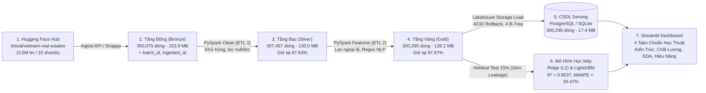

# Kế Hoạch & Báo Cáo Kỹ Thuật (Data & Metrics Plan)
> **Tài liệu tham chiếu chính thức:** Xem bản chi tiết đầy đủ tại [docs/plan_bao_cao.md](file:///e:/House%20Prediction/docs/plan_bao_cao.md).

---

## 1. Sơ Đồ Kiến Trúc Hồ Dữ Liệu 6 Tầng Medallion

---

## 2. Bảng Tóm Tắt Ý Nghĩa Các Con Số Thực Tế

| Con Số Cốt Lõi | Tên Chỉ Số | Ý Nghĩa Kỹ Thuật (Data Engineering) | Ý Nghĩa Nghiệp Vụ Thực Tế (Business Context) |
| :---: | :--- | :--- | :--- |
| **350,075 dòng** | Bản ghi Tầng Đồng (Bronze) | 1 Shard Parquet thô đầy đủ, bảo toàn 100% dữ liệu, gắn `batch_id` truy vết. | Mẫu khảo sát lớn đại diện cho toàn bộ 63 tỉnh/thành phố toàn quốc. |
| **29,686 dòng (8.48%)** | Trùng lặp bị khử | Hàm `dropDuplicates()` trên composite key `[name, province, district, price, area]`. | Môi giới đăng tin lặp lại để giữ bài ở trang đầu; khử trùng giúp tránh Overfit. |
| **12,932 dòng (3.69%)** | Giá null hoặc $\le 0$ | Lọc bỏ bản ghi không có nhãn số thực dương (`price_num <= 0`). | Tin rao "thỏa thuận", "liên hệ", "0 đồng" không thể dùng làm nhãn huấn luyện. |
| **307,457 dòng (87.83%)** | Bản ghi Tầng Bạc (Silver) | **Tỷ lệ giữ lại 87.83%** ($\frac{307,457}{350,075} \times 100\%$). | Loại bỏ an toàn 12.17% dữ liệu rác mà vẫn giữ lại gần 88% giá trị hữu ích. |
| **7,162 dòng (2.33%)** | Ngoại lệ nghiệp vụ bị loại | Lọc 4 nhóm: diện tích [10, 5000 m²], giá [0.1, 500 tỷ], đơn giá [2 tr, 1 tỷ/m²], tầng $\le 25$. | Loại bỏ tin nhập nhầm giá thuê 5 triệu thành giá bán, diện tích $24,000,000\text{ m}^2$. |
| **300,295 dòng (97.67%)** | Bản ghi Tầng Vàng (Gold) | **Tỷ lệ giữ lại 97.67%**, nạp khớp 100% vào cơ sở dữ liệu (`real_estate_gold`). | Bộ dữ liệu sạch chất lượng cao nhất, có cờ NLP (sổ đỏ, ngõ ô tô, mặt tiền). |
| **Giá TV: 7.30 Tỷ** *(Giá TB: 14.57 Tỷ)* | Phân phối lệch phải cực đoan | Giá trung bình cao gấp đôi giá trung vị chứng minh đuôi phân phối rất dài về phía giá cao. | Bằng chứng khoa học bắt buộc phải áp dụng phép biến đổi $\log(1 + \text{giá})$. |
| **Độ lệch chuẩn: 2,006 $\rightarrow$ 25.98 Tỷ** | Giảm phương sai nhiễu | Giảm 77 lần phương sai do loại bỏ tin rác 881,020 tỷ VNĐ. | Giúp các thuật toán học máy hội tụ ổn định, không bị bùng nổ sai số gradient. |
| **Đơn giá TV: 94.2 tr/m²** | Đơn giá đất toàn quốc | Khoảng $Q_1 - Q_3$ từ 49.0 đến 191.7 triệu/m². | Phản ánh chính xác phân khúc nhà ở đô thị tại các trung tâm kinh tế lớn. |
| **Tổng thời gian: 451.4s (~7.5 phút)** | Thời gian toàn trình Pipeline | Thông lượng: Ingest 10k dòng/s, Clean 6.9k dòng/s, Features 4k dòng/s, Load DB 1k dòng/s. | Đạt chuẩn SLA vận hành tự động toàn trình end-to-end cho đồ án Big Data. |
| **$R^2 = 0.8537$** *(Ridge: 0.6266)* | Độ giải thích của mô hình | Đo trên **Tập Kiểm Thử Độc Lập 15% (45,045 mẫu)**, hoàn toàn không rò rỉ dữ liệu. | LightGBM giải thích được 85.37% biến thiên giá, tăng 36.2% so với baseline tuyến tính. |
| **$\text{MdAPE} = 20.47\%$** | Sai số phần trăm trung vị | 50% số căn nhà có sai số dự đoán $\le 20.47\%$. | Đạt ngưỡng tiêu chuẩn của các hệ thống định giá tự động (AVM) quốc tế (15% - 25%). |

---

## 3. Danh Mục Các Biểu Đồ Trực Quan Trong Dự Án

1. Sơ đồ Medallion Architecture 3 Zone Container: `docs/images/00_architecture_flowchart.png`
2. Tác động làm sạch Before vs After: `docs/images/01_pipeline_funnel_retention.png`
3. Tỷ lệ khuyết thiếu dạng thanh ngang: `docs/images/02_data_quality_missing_analysis.png`
4. Biểu đồ hộp và kiểm định phân phối chuẩn hóa: `docs/images/03_distribution_outlier_analysis.png`
5. Bộ 4 biểu đồ khai phá dữ liệu EDA Suite: `docs/images/04_market_distribution.png`
6. Giám sát vận hành Data Pipeline Monitoring Dashboard (Dark Theme): `docs/images/05_pipeline_monitoring_dashboard.png`
7. Đo lường hiệu năng và dung lượng nén Parquet: `docs/images/07_pipeline_performance_storage.png`
