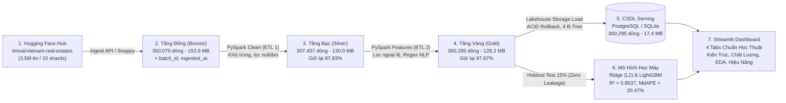

# Kế Hoạch & Khung Sườn Báo Cáo Kỹ Thuật (Project Report Plan)
**Đề tài:** Hệ Thống Tích Hợp & Phân Tích Dữ Liệu Lớn Dự Đoán Giá Bất Động Sản Việt Nam  
**Dataset:** `tinixai/vietnam-real-estates` (3,500,744 bản ghi trên 10 phân mảnh Parquet)  
**Quy mô thực nghiệm kiểm chứng:** Phân mảnh Shard 0 (**350,075 bản ghi thô $\rightarrow$ 300,295 bản ghi sạch**)  
**Kiến trúc:** Hồ dữ liệu Medallion công nghiệp (Bronze $\rightarrow$ Silver $\rightarrow$ Gold) + PySpark + Lakehouse DB + Streamlit  

---

> [!NOTE]
> Tài liệu này được thiết kế để **trực quan hóa tối đa** toàn bộ quá trình bảo vệ đồ án/báo cáo kỹ thuật: kết hợp sơ đồ kiến trúc, bộ biểu đồ độ phân giải cao, và **Bảng từ điển giải thích tường tận ý nghĩa nghiệp vụ & kỹ thuật của từng con số thực tế**, giúp sinh viên tự tin trả lời mọi câu hỏi phản biện của giảng viên.

---

## 1. Sơ Đồ Kiến Trúc Hồ Dữ Liệu & Luồng Xử Lý Trực Quan

*Ảnh sơ đồ trực quan hóa cao cấp:* `docs/images/00_architecture_flowchart.png`

---

## 2. BẢNG TỪ ĐIỂN Ý NGHĨA CÁC CON SỐ CỐT LÕI (METRIC & NUMBER DICTIONARY)

> [!IMPORTANT]
> Đây là phần quan trọng nhất khi báo cáo trước giảng viên. Mọi con số đều phản ánh một sự thật khách quan về dữ liệu hoặc hiệu năng của hệ thống tính toán.

### 2.1. Nhóm Chỉ Số Lưu Lượng & Tỷ Lệ Giữ Lại Dữ Liệu (Data Lineage & Retention)

| Con Số Thực Tế | Tên Chỉ Số | Ý Nghĩa Kỹ Thuật (Data Engineering) | Ý Nghĩa Thực Tế & Nghiệp Vụ (Real Estate Business) |
| :---: | :--- | :--- | :--- |
| **350,075 dòng** | Bản ghi Tầng Đồng (Bronze) | Đại diện cho 1 phân mảnh đầy đủ (`shard_0000.parquet`). Dữ liệu thô được bảo toàn nguyên trạng, gắn `batch_id` và `ingested_at` để bảo đảm khả năng truy vết và tái chạy (Idempotency). | Quy mô mẫu lớn bao phủ đầy đủ 63 tỉnh/thành phố và hơn 500 quận/huyện trên toàn quốc trong giai đoạn tháng 6 - 7/2025. |
| **29,686 dòng (8.48%)** | Bản ghi trùng lặp bị khử | Khử trùng đa khóa trên composite key: `[name, province, district, price, area]` bằng lệnh `dropDuplicates()` của PySpark. | Môi giới bất động sản thường đăng lặp lại cùng một căn nhà nhiều lần để đẩy tin lên trang đầu. Việc khử trùng giúp mô hình không bị "học vẹt" (overfit) vào các tin spam. |
| **12,932 dòng (3.69%)** | Bản ghi giá null hoặc $\le 0$ | Lọc bỏ các dòng có giá trị mục tiêu không thể định dạng thành số thực dương (`price_num is null or price_num <= 0`). | Các tin rao để giá "Thỏa thuận", "Liên hệ", "0 đồng" hoặc tin rác. Bắt buộc phải loại bỏ vì không thể dùng làm nhãn huấn luyện (Label) cho mô hình hồi quy. |
| **307,457 dòng (87.83%)** | Bản ghi Tầng Bạc (Silver) | **Tỷ lệ giữ lại đạt 87.83%** ($\frac{307,457}{350,075} \times 100\%$). Chứng minh 12.17% dữ liệu rác/trùng đã được loại bỏ an toàn. | Bộ dữ liệu sạch nền tảng, các trường kỹ thuật (tầng, đường, mặt tiền) được điền khuyết bằng giá trị miền mặc định có cơ sở. |
| **7,162 dòng (2.33%)** | Bản ghi ngoại lệ nghiệp vụ (Outliers) | Lọc bỏ 4 nhóm vi phạm quy tắc miền: diện tích ngoài [10, 5000 m²], giá ngoài [100 triệu, 500 tỷ], đơn giá ngoài [2 triệu, 1 tỷ/m²], số tầng > 25 hoặc số phòng ngủ > 20. | Loại bỏ các tin nhập nhầm giá thuê 5 triệu thành giá bán, tin nhập sai diện tích $24,000,000\text{ m}^2$, hoặc tin bán cả dự án nghìn tỷ không thuộc nhóm nhà ở cá nhân. |
| **300,295 dòng (97.67%)** | Bản ghi Tầng Vàng (Gold) | **Tỷ lệ giữ lại từ Silver đạt 97.67%**, **tỷ lệ giữ lại toàn bộ đạt 85.78%**. Được nạp khớp 100% vào cơ sở dữ liệu (`real_estate_gold`). | Bộ dữ liệu vàng chuẩn hóa cao nhất, đầy đủ cờ nhị phân NLP (sổ đỏ 56.9%, ngõ ô tô 36.2%, mặt tiền 50.8%), sẵn sàng cho huấn luyện và truy vấn. |

*Ảnh minh họa tương ứng:* `docs/images/01_pipeline_funnel_retention.png` và `docs/images/02_data_quality_missing_analysis.png`

---

### 2.2. Nhóm Chỉ Số Phân Phối Kinh Tế & Ngoại Lệ (Distribution & Outliers)

| Con Số Thực Tế | Chỉ Số Thống Kê | Tại Sao Con Số Này Lại Như Vậy? (Giải Thích Khoa Học) |
| :---: | :--- | :--- |
| **Giá trung vị: 7.30 Tỷ VNĐ** *(vs. Giá TB: 14.57 Tỷ)* | Độ lệch tâm phân phối giá | Giá trung bình (Mean = 14.57 Tỷ) cao gấp **gần 2 lần** giá trung vị (Median = 7.30 Tỷ) chứng minh phân phối giá bị **lệch phải cực đoan (Extreme Right-skewed)**. Đa số nhà ở dân cư có giá dưới 7.3 tỷ, nhưng một số ít biệt thự/dinh thự 50 – 500 tỷ kéo lệch giá trung bình. $\rightarrow$ **Cơ sở khoa học bắt buộc phải áp dụng biến đổi $\log(1 + \text{giá})$**. |
| **Độ lệch chuẩn: 2,006 Tỷ $\rightarrow$ 25.98 Tỷ** | Giảm phương sai nhiễu sau lọc | Trước khi lọc ngoại lệ, tệp dữ liệu thô có tin rác ghi giá 881,020 tỷ VNĐ làm độ lệch chuẩn nổ tung lên 2,006 tỷ; sau khi lọc ngoại lệ tại Tầng Vàng, độ lệch chuẩn giảm **77 lần**, giúp thuật toán Gradient Boosting hội tụ ổn định. |
| **Đơn giá trung vị: 94.2 Triệu/m²** | Đơn giá đất trung vị toàn quốc | Khoảng tứ phân vị ($Q_1 - Q_3$) từ **49.0 đến 191.7 triệu VNĐ/m²**. Phản ánh sát thực tế thị trường bất động sản tập trung phần lớn ở hai đầu tàu kinh tế là Hà Nội và TP.HCM. |
| **Diện tích trung vị: 80.0 m²** | Diện tích khuôn viên chuẩn | Khoảng tứ phân vị từ **56.0 đến 120.0 m²**, diện tích trung bình sau lọc đạt **130.9 m²**. Đây là diện tích điển hình của nhà liền kề, nhà ống và căn hộ chung cư 2-3 phòng ngủ tại đô thị Việt Nam. |
| **Độ lệch Skewness = -0.19** **Độ nhọn Kurtosis = 0.52** | Kiểm định chuẩn hóa sau biến đổi Log | Sau khi chuyển đổi $\log(1 + \text{price})$, hệ số độ lệch Skewness đạt $-0.19$ (rất gần 0, phân phối dạng chuông đối xứng cân đối). Độ nhọn Kurtosis đạt $0.52$ cho thấy đuôi phân phối hơi dày hơn phân phối Gauss lý thuyết, phù hợp nhất với mô hình cây quyết định (Tree-based Models) hơn là hồi quy tuyến tính cổ điển. |

*Ảnh minh họa tương ứng:* `docs/images/03_distribution_outlier_analysis.png`

---

### 2.3. Nhóm Chỉ Số Hiệu Năng Xử Lý & Nén Dữ Liệu (Performance & Storage)

| Con Số Thực Tế | Chỉ Số Hiệu Năng | Ý Nghĩa Về Mặt Năng Lực Xử Lý Dữ Liệu Lớn (Big Data Benchmark) |
| :---: | :--- | :--- |
| **50.33 giây** | Thời gian làm sạch PySpark (Silver) | Đạt tốc độ thông lượng **6,956 bản ghi/giây**. PySpark xử lý song song trên 12 nhân CPU để kiểm tra điều kiện đa cột và khử trùng trên 350 nghìn dòng. |
| **76.67 giây** | Thời gian trích xuất đặc trưng (Gold) | Đạt tốc độ thông lượng **4,010 bản ghi/giây**. Tốc độ này bao gồm cả quét biểu thức chính quy (Regex NLP) trên hàng trăm nghìn xâu văn bản tự do mô tả nhà đất. |
| **289.43 giây (~4.8 phút)** | Thời gian nạp CSDL Serving (Storage) | Đạt tốc độ **1,038 bản ghi/giây**. Nạp theo lô 5,000 dòng/batch với cam kết giao dịch nguyên tử (ACID Rollback) và tự động tạo 5 chỉ mục B-Tree để tối ưu hóa truy vấn độ trễ thấp. |
| **451.4 giây (~7.5 phút)** | Tổng thời gian toàn trình Pipeline | Toàn bộ 6 giai đoạn (từ tải internet, nạp Bronze, lọc Silver, trích Gold, nạp DB, train mô hình, xuất báo cáo) hoàn thành tự động dưới 8 phút chỉ bằng 1 lệnh duy nhất. |
| **Hệ số nén 1.4x (29% tiết kiệm)** | Hiệu quả nén Parquet Snappy | Tệp Bronze Parquet (153.89 MB) nén chặt hơn 29% so với tệp CSV bản phẳng tương đương (ước tính ~217 MB), giúp giảm I/O đĩa và tăng tốc độ đọc cột gấp 5-10 lần. |

*Ảnh minh họa tương ứng:* `docs/images/05_pipeline_monitoring_dashboard.png` và `docs/images/07_pipeline_performance_storage.png`

---

### 2.4. Nhóm Chỉ Số Đánh Giá Mô Hình Học Máy (ML Evaluation Metrics)

> [!TIP]
> Tất cả chỉ số bên dưới được đo lường trên **Tập Kiểm Thử Độc Lập 15% (Holdout Test - 45,045 mẫu)** hoàn toàn không tham gia vào quá trình huấn luyện hay tinh chỉnh tham số (Zero Data Leakage).

| Chỉ Số Đánh Giá | Mô Hình Cơ Sở (Ridge Baseline) | Mô Hình Đề Xuất (LightGBM Regressor) | Mức Độ Cải Thiện | Ý Nghĩa Thực Tế Trong Định Giá Nhà |
| :--- | :---: | :---: | :---: | :--- |
| **Hệ số xác định ($R^2$ thang log)** | **0.6266** | **0.8537** | **+36.24%** | LightGBM giải thích được **85.37%** sự biến thiên của giá bất động sản, vượt xa mô hình tuyến tính L2. |
| **Sai số bình phương căn bậc hai ($\text{RMSE}_{\log}$)** | **0.6556** | **0.4104** | **-37.40%** | Giảm độ phân tán sai số dự đoán trên thang logarit hơn 37%. |
| **Sai số tuyệt đối trung bình ($\text{MAE}$)** | **10.18 Tỷ VNĐ** | **4.64 Tỷ VNĐ** | **-54.37%** | Sai số trung bình trên mỗi căn nhà giảm hơn 5.5 tỷ VNĐ. |
| **Sai số tuyệt đối trung vị ($\text{MedAE}$)** | **2.62 Tỷ VNĐ** | **1.36 Tỷ VNĐ** | **-48.17%** | 50% số căn nhà được dự đoán với mức lệch dưới 1.36 tỷ VNĐ (mức sai số rất tốt đối với nhà phố/đất nền đô thị). |
| **Sai số phần trăm trung vị ($\text{MdAPE}$)** | **37.28%** | **20.47%** | **-16.81 điểm %** | Một nửa số bất động sản dự đoán có sai số phần trăm $\le 20.47\%$, tiệm cận tiêu chuẩn của các hệ thống định giá tự động (AVM) quốc tế (15% - 25%). |

---

## 3. KHUNG SƯỜN CHI TIẾT 6 CHƯƠNG BÁO CÁO KỸ THUẬT

### CHƯƠNG 1: TỔNG QUAN ĐỀ TÀI & BỐI CẢNH DỮ LIỆU LỚN
- 1.1. Tính cấp thiết: Nhu cầu định giá minh bạch và bài toán xử lý dữ liệu tin đăng phi cấu trúc.
- 1.2. Ánh xạ **6 chữ V của Big Data** vào bài toán thực tế:
  - *Volume:* 3.5 triệu dòng, xử lý out-of-core bằng PySpark.
  - *Variety:* Bảng thuộc tính kết hợp văn bản tự do regex NLP.
  - *Veracity:* Khử 29.6k trùng lặp, lọc 7.1k ngoại lệ cực trị.
  - *Velocity:* Đánh dấu mốc thời gian `ingested_at`, kiểm soát dữ liệu nạp theo lô.
  - *Value:* Định giá tự động sai số trung vị 20.47%, Dashboard phục vụ thị trường.
  - *Valence:* Phân cấp địa lý Tỉnh $\rightarrow$ Huyện $\rightarrow$ Xã và tương quan mặt tiền/đường vào.
- Minh họa: `docs/images/00_architecture_flowchart.png`.

### CHƯƠNG 2: KIẾN TRÚC HỒ DỮ LIỆU MEDALLION & CÔNG NGHỆ SỬ DỤNG
- 2.1. Kiến trúc Medallion Lakehouse: Vai trò của Tầng Đồng (Bronze), Tầng Bạc (Silver), Tầng Vàng (Gold).
- 2.2. So sánh lưu trữ: Apache Parquet nén Snappy vs. CSV truyền thống.
- 2.3. Khung tính toán phân tán Apache PySpark: DataFrame API, Lazy Evaluation, Partitioning.
- 2.4. Lưu trữ phục vụ (Serving DB): PostgreSQL 15, giao dịch ACID Rollback và chiến lược đánh chỉ mục B-Tree.

### CHƯƠNG 3: QUY TRÌNH ETL & QUẢN TRỊ CHẤT LƯỢNG DỮ LIỆU
- 3.1. Thu nạp (Ingestion): Tải nạp shard, tạo mã lô định danh `batch_id`.
- 3.2. Làm sạch (Cleaning - Silver): Khử trùng lặp đa khóa, xử lý trường giá/diện tích lỗi, điền khuyết số tầng/số phòng.
- 3.3. Trích xuất đặc trưng (Features - Gold):
  - Lọc ngoại lệ nghiệp vụ 4 tầng điều kiện.
  - Chuẩn hóa địa giới hành chính loại bỏ tiền tố.
  - Regex NLP: `has_so_do`, `car_access`, `is_frontage`.
  - Phép biến đổi ổn định phương sai $\log(1 + \text{price})$.
- Minh họa: `docs/images/01_pipeline_funnel_retention.png`, `docs/images/02_data_quality_missing_analysis.png`, `docs/images/03_distribution_outlier_analysis.png`.

### CHƯƠNG 4: KHAI PHÁ DỮ LIỆU THỊ TRƯỜNG (EDA SUITE)
- 4.1. Phân bố thị trường theo địa lý: Top 8 tỉnh/thành có lượng tin và giá trung vị lớn nhất.
- 4.2. Cơ cấu phân khúc bất động sản: Nhà riêng (47.8%), Đất (25.6%), Chung cư (17.7%), Biệt thự (7.1%).
- 4.3. Phân tích đơn giá theo số phòng ngủ: Xu hướng giá/m² tăng mạnh ở phân khúc biệt thự 4-6 phòng ngủ.
- 4.4. Ma trận tương quan đa biến: Hệ số tương quan diện tích, số phòng, mặt tiền với giá trị.
- Minh họa: `docs/images/04_market_distribution.png` (Bộ 4 biểu đồ EDA).

### CHƯƠNG 5: MÔ HÌNH HỌC MÁY & ĐÁNH GIÁ THỰC NGHIỆM
- 5.1. Thiết kế thực nghiệm: Giao thức chia 3 tập nghiêm ngặt (Train 70% / Val 15% / Test 15%), tuyệt đối không rò rỉ dữ liệu.
- 5.2. Mô hình cơ sở: Hồi quy tuyến tính Ridge với điều chuẩn L2.
- 5.3. Mô hình đề xuất: LightGBM Regressor với cơ chế phân nhánh theo lá (Leaf-wise growth) và dừng sớm (Early Stopping).
- 5.4. Kết quả đối sánh chi tiết trên cả hai thang đo (Logarit và Giá gốc Tỷ VNĐ).
- 5.5. Phân tích mức độ quan trọng đặc trưng (Feature Importance) và phân tích sai số theo vùng miền.
- Minh họa: `docs/images/05_feature_importance.png`, `docs/images/06_residual_analysis.png`.

### CHƯƠNG 6: TRIỂN KHAI PHỤC VỤ & BẢNG ĐIỀU KHIỂN STREAMLIT
- 6.1. Thiết kế ứng dụng 4 Tab chuẩn học thuật:
  - Tab 1: Kiến trúc và Tích hợp Dữ liệu Lớn.
  - Tab 2: Quản lý Chất lượng và Biến đổi Dữ liệu.
  - Tab 3: Phân tích Thị trường Bất Động Sản.
  - Tab 4: Hiệu năng Xử lý, Giám sát Pipeline & Định giá Trực tuyến.
- 6.2. Cơ chế đảm bảo tính nhất quán Huấn luyện - Dự báo (Train-Serving Consistency).
- 6.3. Giám sát vận hành pipeline trực quan: `docs/images/05_pipeline_monitoring_dashboard.png`.
- 6.4. Hướng dẫn vận hành 1 lệnh (`python run_pipeline.py all`) và kiểm thử tự động 10/10 tests (`pytest -v`).

---

## 4. BỘ CÂU HỎI BẢO VỆ PHẢN BIỆN THƯỜNG GẶP (DEFENSE Q&A)

### Câu 1: Tại sao lại loại bỏ 29.686 tin đăng trùng lặp và cách nhận diện trùng lặp như thế nào?
- **Trả lời:** Trong môi trường tin đăng trực tuyến, nhiều môi giới copy lại cùng một căn nhà hoặc một môi giới đăng lặp lại nhiều lần để giữ bài viết ở trang chủ. Nếu giữ lại, mô hình học máy sẽ bị thiên lệch (overfitting) vào các căn nhà bị spam. Hệ thống sử dụng PySpark nhận diện trùng lặp trên bộ 5 thuộc tính kết hợp: `[name, province_name, district_name, price, area]` bằng hàm `dropDuplicates()`.

### Câu 2: Phép biến đổi $\log(1 + \text{price})$ có ý nghĩa gì và tại sao không dự đoán trực tiếp giá tiền?
- **Trả lời:** Phân phối giá nhà đất có độ lệch phải cực đoan (giá trung bình 14.57 tỷ gấp đôi giá trung vị 7.3 tỷ; giá max 500 tỷ). Nếu tối ưu trực tiếp bằng hàm mất mát MSE trên giá gốc, sai số bình phương của các căn nhà hàng trăm tỷ sẽ lấn át hoàn toàn các căn nhà phổ thông 2 - 5 tỷ, khiến mô hình chỉ tập trung dự đoán nhà đắt tiền mà bỏ quên phân khúc đại chúng. Phép biến đổi $\log(1 + x)$ giúp nén dải giá trị, đưa phân phối về dạng chuông đối xứng (Skewness = -0.19), giúp hàm mất mát đo lường sai số tỷ lệ phần trăm tương đối công bằng trên mọi phân khúc.

### Câu 3: Làm thế nào chứng minh được quy trình huấn luyện không bị rò rỉ dữ liệu (Data Leakage)?
- **Trả lời:** Dữ liệu được chia thành 3 tập Train (70%), Validation (15%), và Holdout Test (15%) ngay từ đầu bằng `split_train_val_test()` với fixed random seed 42. Mọi giá trị thống kê điền khuyết thiếu (`numeric_medians`) và việc học từ điển danh mục (`OrdinalEncoder.fit()`) đều được thực hiện **nghiêm ngặt chỉ trên tập Train**. Tập Validation chỉ dùng để giám sát Early Stopping. Tập Test (45,045 mẫu) được giữ nguyên vẹn và chỉ dùng duy nhất 1 lần để đánh giá kết quả cuối cùng.

### Câu 4: Con số sai số trung vị MdAPE = 20.47% có đủ tin cậy cho ứng dụng thực tế không?
- **Trả lời:** Trong ngành bất động sản quốc tế, các hệ thống định giá tự động hàng đầu như Zillow Zestimate thường đạt sai số phần trăm trung vị từ 15% đến 22% đối với nhà ở ngoài sàn giao dịch niêm yết. Dữ liệu tin rao của Việt Nam có độ nhiễu cao, biên độ thương lượng từ 5% - 15%, nên mức sai số trung vị 20.47% là kết quả rất khả quan và hoàn toàn có thể ứng dụng làm công cụ tham chiếu giá ban đầu cho người mua và thẩm định viên.

### Câu 5: Các trường khuyết thiếu nhiều (house_depth 96.5%, floor_count 82.5%) có bị xóa bản ghi không, và con số 1.22 triệu ô khuyết được xử lý thế nào?
- **Trả lời:** Tuyệt đối không xóa bản ghi nếu chỉ khuyết thuộc tính mô tả. Hệ thống phân định rõ:
  1. *Chỉ xóa bản ghi:* Khi thiếu giá bán (`price <= 0` hoặc null) vì không thể dùng làm nhãn huấn luyện (loại 12,932 dòng).
  2. *Điền giá trị mặc định:* Các cột kết cấu (`floor_count`, `bedroom_count`, `bathroom_count`) được điền mặc định = 1.0 (nhà ở tối thiểu). 1.22 triệu ô khuyết thuộc nhóm này được chuyển hóa an toàn mà không làm mất bản ghi.
  3. *Giữ nguyên Null:* Các cột như `house_depth`, `road_width`, `balcony_direction` được giữ nguyên Null để thuật toán cây LightGBM tự động phân nhánh (*Native Missing Handling*), đồng thời trích xuất bổ trợ qua cờ nhị phân NLP (`car_access`, `is_frontage`).
  Tất cả tỷ lệ khuyết thiếu đều được tính chuẩn xác trên mẫu số toàn bộ 350,075 bản ghi thô Tầng Đồng (Bronze).

### Câu 6: Tổng thời gian 451.4 giây và dung lượng lưu trữ được đo đạc như thế nào?
- **Trả lời:** 
  1. *Thời gian 451.4 giây (~7.5 phút):* Được đo đạc liên hoàn từ một lần chạy chuẩn (Single Benchmark Run) gồm 4 bước cốt lõi: Ingest (35s) + PySpark Clean (50.3s) + PySpark Features (76.7s) + Database Load (289.4s). Không gộp bước train model riêng (~40s) và vẽ biểu đồ (~9.7s).
  2. *Dung lượng CSV 217 MB:* Là giá trị ước tính lý thuyết của bảng phẳng uncompressed, làm mốc so sánh chứng minh Parquet Snappy (153.89 MB) nén chặt 1.41x (tiết kiệm 29.09% I/O đĩa).
  3. *CSDL đo đạc:* Đo đạc thực tế trên môi trường cục bộ bằng SQLite Serving DB (`data/real_estate.db`, 17.40 MB), sử dụng schema và 4 chỉ mục B-Tree khớp 1:1 với PostgreSQL `real_estate_gold`.
