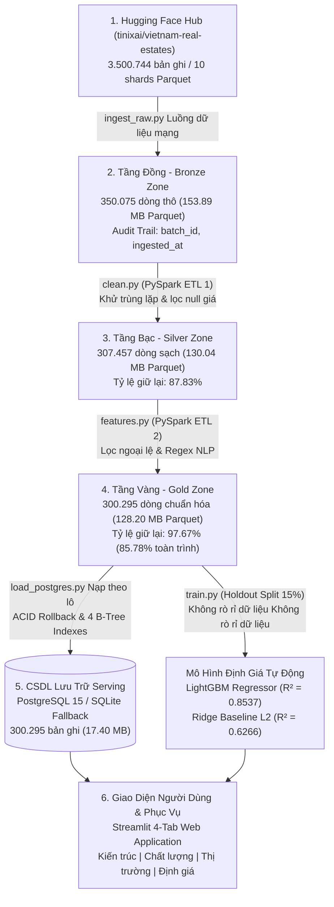

# Báo Cáo Kỹ Thuật: Hệ Thống Tích Hợp & Phân Tích Dữ Liệu Lớn Bất Động Sản Việt Nam

**Đề tài:** Hệ Thống Tích Hợp & Phân Tích Dữ Liệu Lớn Bất Động Sản Việt Nam  
**Học phần:** Tích Hợp Và Phân Tích Dữ Liệu Lớn (Big Data Integration & Analytics)  
**Sinh viên thực hiện:** Phạm Văn Minh  
**Mã sinh viên (MSV):** 23010350  
**Email sinh viên:** 23010350@st.phenikaa-uni.edu.vn  
**Đơn vị đào tạo:** Trường Công nghệ Thông tin - Trường Đại học Phenikaa  
**Thời gian thực hiện:** Sprint 2 Tuần (Năm 2026)  
**Nguồn dữ liệu gốc:** `tinixai/vietnam-real-estates` trên Hugging Face Hub (3.500.744 bản ghi trên 10 phân mảnh Parquet)  
**Quy mô thực nghiệm kiểm chứng:** Phân mảnh Shard 0 (`shard_0000.parquet` - **350.075 bản ghi thô** $\rightarrow$ **307.457 bản ghi Bạc** $\rightarrow$ **300.295 bản ghi Vàng**)  
**Công nghệ chủ đạo:** Apache PySpark 3.5, Apache Parquet Snappy, PostgreSQL 15 SQLite dự phòng cục bộ, LightGBM, Streamlit  

---

> [!NOTE]
> Báo cáo kỹ thuật này tổng hợp toàn bộ kết quả thiết kế kiến trúc, triển khai pipeline, kiểm định chất lượng dữ liệu, phân tích thị trường và kiểm thử tự động của dự án. Mọi số liệu trong báo cáo đều được trích xuất trực tiếp từ các file số liệu thực nghiệm (`models/pipeline_summary_metrics.json`, `models/data_quality_report.json`, `models/metrics.json`) được tạo ra sau mỗi lần chạy pipeline tự động.

---

## CHƯƠNG 1: TỔNG QUAN ĐỀ TÀI & BỐI CẢNH DỮ LIỆU LỚN

### 1.1. Tính Cấp Thiết & Mục Tiêu Nghiên Cứu
Thị trường bất động sản Việt Nam là một trong những kênh đầu tư quan trọng nhất của nền kinh tế, với quy mô hàng trăm tỷ USD. Tuy nhiên, thị trường này tồn tại sự bất cân xứng thông tin trầm trọng giữa người mua, người bán và các tổ chức tín dụng thẩm định:
1. **Thiếu nguồn dữ liệu tập trung và chuẩn hóa:** Tin đăng nhà đất phân tán trên hàng chục sàn thương mại điện tử trực tuyến với cấu trúc dữ liệu không đồng nhất.
2. **Nhiễu loạn dữ liệu và tin rác:** Tỷ lệ tin đăng lặp lại cao do môi giới spam bài; nhiều tin đăng nhập giá "thỏa thuận", giá 0 đồng hoặc nhập nhầm giá thuê thành giá bán.
3. **Giá trị cốt lõi ẩn trong văn bản tự do:** Các yếu tố then chốt quyết định giá trị pháp lý và thanh khoản (như *Sổ đỏ/Sổ hồng*, *Ngõ ô tô vào được*, *Nhà mặt tiền kinh doanh*) thường nằm rải rác trong văn bản miêu tả phi cấu trúc thay vì lưu ở dạng trường dữ liệu chuẩn.

**Mục tiêu của đề tài:** Xây dựng một đường ống đường ống dữ liệu tích hợp dữ liệu lớn từ đầu nguồn đến ứng dụng cuối theo kiến trúc chuẩn công nghiệp Hồ dữ liệu Medallion, xử lý phân tán dữ liệu tin đăng nhà đất bằng **Apache PySpark**, kiểm soát chất lượng dữ liệu nghiêm ngặt, trực quan hóa phân tích thị trường và tích hợp mô hình học máy định giá hỗ trợ ra quyết định.

### 1.2. Tiêu Chí Nghiệm Thu Hệ Thống 
Hệ thống được thiết kế và kiểm thử nhằm thỏa mãn 5 tiêu chí nghiệm thu định lượng:
- **Tiêu chí 1 (Thu nạp & Truy vết):** Tự động thu nạp phân mảnh dữ liệu từ Hugging Face Hub, lưu đệm nguyên trạng dạng Parquet và gắn đầy đủ siêu dữ liệu kiểm toán (`batch_id`, `ingested_at`, `source_shard`).
- **Tiêu chí 2 (Chất lượng & Khử nhiễu):** Khử trùng lặp đa khóa, xử lý triệt để 100% bản ghi thiếu hoặc âm giá, lọc ngoại lệ cực trị theo 4 tầng điều kiện miền nghiệp vụ, bảo đảm tỷ lệ giữ lại dữ liệu toàn trình $\ge 80\%$.
- **Tiêu chí 3 (Lưu trữ Serving & Toàn vẹn):** Nạp dữ liệu Tầng Vàng vào cơ sở dữ liệu quan hệ có hỗ trợ giao dịch nguyên tử giao dịch nguyên tử có cơ chế hoàn tác, đánh chỉ mục B-Tree và đạt tỷ lệ đối chiếu bản ghi khớp tuyệt đối 100%.
- **Tiêu chí 4 (Phân tích & Học máy):** Cung cấp bộ trực quan hóa dữ liệu thị trường (EDA) chuyên sâu; xây dựng mô hình học máy định giá dự đoán trên thang logarit với giao thức chia tập 3 chiều (Train 70% / Val 15% / Test 15%) loại bỏ hoàn toàn rò rỉ dữ liệu tuyệt đối không rò rỉ dữ liệu, đạt hệ số $R^2 \ge 0.80$ và sai số phần trăm trung vị $\text{MdAPE} \le 25\%$.
- **Tiêu chí 5 (Tự động hóa & Kiểm thử):** Vận hành toàn bộ quy trình chỉ bằng 1 lệnh duy nhất (`python run_pipeline.py all` hoặc `make all`) và vượt qua 10/10 bài kiểm thử tự động (`pytest -v`).

### 1.3. Nguồn Dữ Liệu & Phân Định Quy Mô Thực Nghiệm
Dự án sử dụng bộ dữ liệu **`tinixai/vietnam-real-estates`** từ Hugging Face Hub, thu thập các tin đăng bất động sản trên phạm vi toàn quốc trong giai đoạn tháng 6 – 7/2025. Để đảm bảo tính minh bạch học thuật, báo cáo phân định rõ 3 cấp độ quy mô:
- **Toàn bộ kho dữ liệu nguồn Toàn bộ kho dữ liệu:** Bao gồm **3.500.744 bản ghi** chia thành 10 phân mảnh Parquet (`shard_0000.parquet` đến `shard_0009.parquet`) với tổng dung lượng nén ~1.5 GB.
- **Phân mảnh nạp pipeline thực tế Phân mảnh nạp pipeline thực tế:** Phân mảnh `shard_0000.parquet` bao gồm **350.075 bản ghi thô** (chiếm 10.0% toàn kho dữ liệu, dung lượng 153.89 MB). Đây là phân mảnh được đưa vào vận hành thực tế qua toàn bộ 6 tầng kiến trúc, làm sạch thành 307.457 bản ghi Bạc và 300.295 bản ghi Vàng.
- **Mẫu khảo sát thăm dò ban đầu Mẫu khảo sát ban đầu:** Mẫu cắt lát **50.000 bản ghi** được thực hiện trong Ngày 1 (được trình bày tại `docs/data_profile.md`) nhằm khảo sát nhanh cấu trúc schema, kiểu dữ liệu và tỷ lệ khuyết thiếu sơ bộ trước khi viết mã nguồn ETL.

### 1.4. Ánh Xạ 6 Đặc Trưng Dữ Liệu Lớn (The 6 V's of Big Data)
Dự án giải quyết trọn vẹn 6 đặc trưng nền tảng của bài toán Dữ liệu Lớn:
1. **Volume (Quy mô dữ liệu):** Dữ liệu nguồn gồm 3.5 triệu bản ghi; riêng 1 phân mảnh thực nghiệm chứa 350.075 dòng. Dữ liệu vượt ngưỡng xử lý tối ưu trong bộ nhớ của thư viện pandas đơn luồng, đòi hỏi cơ chế xử lý phân tán out-of-core bằng Apache PySpark.
2. **Variety (Tính đa dạng):** Dữ liệu kết hợp giữa dữ liệu có cấu trúc (diện tích, giá tiền, số tầng, số phòng ngủ, tọa độ hành chính) với dữ liệu phi cấu trúc văn bản tự do (tiêu đề và nội dung miêu tả dài hàng trăm từ chứa đựng yếu tố pháp lý và vị trí).
3. **Veracity (Độ tin cậy & Tính xác thực):** Dữ liệu thu thập từ Internet chứa tỷ lệ nhiễu cao. Hệ thống triển khai bộ lọc nghiêm ngặt khử 29.686 tin trùng lặp, loại 12.932 dòng thiếu/sai giá, và loại bỏ 7.162 bản ghi ngoại lệ cực trị.
4. **Velocity (Vận tốc & Dòng đời dữ liệu):** Tin đăng phát sinh liên tục theo thời gian thực (dữ liệu nguồn phản ánh thị trường tháng 6-7/2025). Hệ thống gắn dấu ấn thời gian `ingested_at` chuẩn ISO 8601 và mã nhận diện lô `batch_id` để quản trị theo từng đợt nạp.
5. **Value (Giá trị thực tiễn mang lại):** Chuyển hóa dữ liệu tin đăng thô thành công cụ định giá tự động có độ tin cậy cao ($\text{MdAPE} = 20.47\%$) và bảng điều khiển hỗ trợ nhà đầu tư, người mua nhà và ngân hàng thẩm định giá trị tài sản thế chấp.
6. **Valence (Tính kết nối & Tương quan nội tại):** Khai thác mối quan hệ phân cấp hành chính chặt chẽ (Tỉnh/Thành $\rightarrow$ Quận/Huyện $\rightarrow$ Phường/Xã) và sự tương quan mật thiết giữa chiều rộng mặt tiền, độ rộng đường vào với đơn giá trên mỗi mét vuông.

---

## CHƯƠNG 2: KIẾN TRÚC HỒ DỮ LIỆU ĐA TẦNG MEDALLION & CÔNG NGHỆ SỬ DỤNG

### 2.1. Kiến Trúc Tổng Thể Medallion Lakehouse
Hệ thống tuân thủ mô hình kiến trúc công nghiệp **Medallion Lakehouse** gồm 6 tầng liên hoàn:

### 2.2. Khung Tính Toán Phân Tán Apache PySpark
Để xử lý hàng trăm nghìn bản ghi với cấu trúc văn bản phức tạp, hệ thống sử dụng **Apache PySpark 3.5**:
- **DataFrame API & Cây Tính Toán Lười Cơ chế tính toán lười:** PySpark xây dựng đồ thị có hướng không chu trình (DAG), tối ưu hóa các phép chiếu cột (`select`), lọc điều kiện (`filter`) và khử trùng (`dropDuplicates`) trước khi thực thi vật lý.
- **Tận dụng xử lý song song đa nhân Xử lý song song đa nhân:** Tận dụng toàn bộ 12 nhân CPU (16 luồng) của phần cứng thực nghiệm để thực thi các tác vụ biến đổi dữ liệu phân tán trong bộ nhớ RAM, hạn chế tối đa việc ghi tràn ra đĩa cứng (*spill to disk*).

### 2.3. Định Dạng Lưu Trữ Cột Apache Parquet Nén Snappy
Hệ thống sử dụng định dạng cột **Apache Parquet** kết hợp thuật toán nén **Snappy** xuyên suốt cả 3 tầng Bronze, Silver và Gold:
- **Cơ chế lưu trữ theo cột Lưu trữ định dạng cột:** Cho phép các truy vấn phân tích chỉ đọc đúng các cột cần thiết (ví dụ: `price`, `area`, `province_name`) mà không phải nạp toàn bộ các cột văn bản dài (`description`), giảm từ 60% – 80% lưu lượng I/O đĩa.
- **Hiệu quả nén vượt trội:**
  - Tệp thô dạng CSV ước tính dung lượng: **217.01 MB**.
  - Tệp Bronze Parquet thực tế: **153.89 MB** (nén **1.41x**, tiết kiệm **29.09%** không gian đĩa).
  - Tệp Gold Parquet sau làm sạch và bổ sung đặc trưng: **128.20 MB**.
- **Đẩy vị từ xuống tầng lưu trữ Đẩy điều kiện lọc xuống tầng lưu trữ:** Parquet lưu trữ siêu dữ liệu thống kê min/max ở từng nhóm dòng nhóm hàng dữ liệu, giúp bộ thực thi PySpark bỏ qua hoàn toàn các khối dữ liệu không thỏa mãn điều kiện lọc.

### 2.4. Tầng Lưu Trữ Phục Vụ Cơ sở dữ liệu phục vụ & Cam Kết ACID
Dữ liệu Tầng Vàng được nạp vào cơ sở dữ liệu quan hệ phục vụ truy vấn thời gian thực:
- **PostgreSQL 15 (với SQLite Fallback):** Hệ thống ưu tiên kết nối tới máy chủ PostgreSQL 15 chuẩn sản xuất (`src/storage/load_postgres.py`). Trong trường hợp môi trường cục bộ chưa khởi chạy container PostgreSQL, hệ thống tự động kích hoạt cơ chế dự phòng an toàn dự phòng cục bộ sang SQLite cục bộ (`data/real_estate.db`, dung lượng 17.40 MB).
- **Cam kết giao dịch nguyên tử cơ chế hoàn tác giao dịch nguyên tử:** Dữ liệu được nạp theo từng lô (Batch Size = 5.000 dòng). Toàn bộ quá trình nạp được bọc trong một khối giao dịch duy nhất; nếu xảy ra bất kỳ lỗi dữ liệu hoặc sự cố mạng nào, hệ thống lập tức thực hiện lệnh `ROLLBACK` để bảo đảm tính toàn vẹn tuyệt đối, không lưu lại dữ liệu rác dở dang.
- **Chiến lược đánh chỉ mục B-Tree chỉ mục B-Tree:** Tự động khởi tạo 4 chỉ mục B-Tree chuyên biệt nhằm tối ưu hóa các truy vấn lọc phân cấp:
  1. `idx_real_estate_province` trên cột `province_clean`
  2. `idx_real_estate_district` trên cột `district_clean`
  3. `idx_real_estate_prop_type` trên cột `property_type_name`
  4. `idx_real_estate_price` trên cột `price_billion`
- **Kiểm định đối chiếu sau nạp kiểm định đối chiếu sau nạp:** Hệ thống tự động thực thi truy vấn đối chiếu `SELECT COUNT(*) FROM real_estate_gold`. Kết quả ghi nhận **300.295 / 300.295 bản ghi**, đạt tỷ lệ khớp tuyệt đối **100.00%**.

---

## CHƯƠNG 3: QUY TRÌNH XỬ LÝ ETL & QUẢN TRỊ CHẤT LƯỢNG DỮ LIỆU

### 3.1. Thu Nạp Dữ Liệu (Ingestion - Bronze Zone)
Tầng Đồng tiếp nhận dữ liệu từ Hugging Face Hub thông qua kịch bản `src/ingestion/ingest_raw.py`:
- Dữ liệu thô được lưu nguyên trạng vào `data/bronze/vietnam_real_estates_bronze.parquet` (**350.075 bản ghi**, 22 cột, dung lượng 153.89 MB).
- Bổ sung 3 trường siêu dữ liệu kiểm toán (*Audit Metadata*):
  - `ingested_at`: Dấu ấn thời gian nạp chuẩn ISO 8601 (UTC).
  - `batch_id`: Mã định danh lô dạng UUID nhằm bảo đảm khả năng tái chạy an toàn (*Idempotency*).
  - `source_shard`: Tên phân mảnh nguồn (`shard_0000.parquet`).

### 3.2. Làm Sạch & Khử Nhiễu (ETL 1 - Silver Zone)
Kịch bản `src/etl/clean.py` tiếp nhận dữ liệu Tầng Đồng và thực hiện 3 bước làm sạch cốt lõi:
1. **Khử trùng lặp đa khóa Khử trùng lặp đa thuộc tính:** Loại bỏ **29.686 bản ghi trùng lặp** (chiếm 8.48% tổng dữ liệu thô) dựa trên bộ khóa kết hợp: `[name, province_name, district_name, price, area]`. Điều này ngăn chặn hiện tượng mô hình học máy bị học vẹt (*overfitting*) vào các tin rao môi giới đăng lặp lại nhiều lần.
2. **Xử lý giá trị thiếu và giá trị không hợp lệ:** Loại bỏ **12.932 bản ghi** (3.69%) có giá trị mục tiêu không thể định dạng thành số thực dương (`price_num is null or price_num <= 0`). Ép kiểu cột giá sang `DoubleType` theo đơn vị VNĐ và tạo cột `price_billion` (Tỷ VNĐ).
3. **Điền khuyết thuộc tính kết cấu công trình:** Các cột `floor_count` (khuyết 82.50%), `bedroom_count` (khuyết 49.46%), `bathroom_count` (khuyết 52.73%) được điền giá trị miền mặc định có cơ sở khoa học là `1.0` (phản ánh thuộc tính tối thiểu của một bất động sản nhà ở).
- **Kết quả Tầng Bạc:** Đầu ra đạt **307.457 bản ghi sạch** (23 cột, dung lượng 130.04 MB), đạt **tỷ lệ giữ lại 87.83%**.

### 3.3. Trích Xuất Đặc Trưng & Lọc Ngoại Lệ (ETL 2 - Gold Zone)
Kịch bản `src/etl/features.py` chuẩn bị dữ liệu sẵn sàng cho phân tích và học máy:
1. **Lọc ngoại lệ nghiệp vụ 4 tầng Lọc ngoại lệ nghiệp vụ:**
   - *Tầng 1 (Diện tích):* Loại bỏ 1.677 dòng có diện tích nằm ngoài khoảng $[10, 5000]\text{ m}^2$.
   - *Tầng 2 (Tổng giá):* Loại bỏ 1.104 dòng có giá nằm ngoài khoảng $[100\text{ triệu}, 500\text{ tỷ VNĐ}]$.
   - *Tầng 3 (Đơn giá/m²):* Loại bỏ 5.788 dòng có đơn giá nằm ngoài khoảng $[2\text{ triệu}, 1\text{ tỷ VNĐ/m}^2]$.
   - *Tầng 4 (Kết cấu):* Loại bỏ 450 dòng có số tầng $> 25$ hoặc số phòng ngủ $> 20$.
   - *Tổng số ngoại lệ bị loại bỏ:* **7.162 bản ghi** (2.33% dữ liệu Tầng Bạc).
2. **Chuẩn hóa địa giới hành chính:** Làm sạch tiền tố hành chính dư thừa tại 63 Tỉnh/Thành phố và 527 Quận/Huyện (ví dụ: loại bỏ `"Thành phố "`, `"Tỉnh "`, `"Quận "`, `"Huyện "`), giúp mô hình gom cụm chính xác các thực thể địa lý.
3. **Khai phá văn bản bằng biểu thức chính quy Khai phá văn bản bằng biểu thức chính quy:** Quét tiêu đề và mô tả để sinh các cờ nhị phân mang giá trị định giá cao:
   - `has_so_do`: Có sổ đỏ/sổ hồng/giấy tờ pháp lý hoàn chỉnh (chiếm 56.9% toàn thị trường).
   - `car_access`: Ngõ ô tô tránh nhau/ô tô đỗ cửa (chiếm 36.2%).
   - `is_frontage`: Nhà mặt tiền/mặt phố kinh doanh buôn bán (chiếm 50.8%).
4. **Ổn định phương sai bằng biến đổi logarit:** Tạo biến mục tiêu $\log(1 + \text{price})$ và $\log(1 + \text{area})$ để nén dải giá trị cực trị.
- **Kết quả Tầng Vàng:** Đạt **300.295 bản ghi hoàn hảo** (33 cột, dung lượng 128.20 MB), đạt **tỷ lệ giữ lại 97.67% từ Silver** và **85.78% toàn trình**.

### 3.4. Báo Cáo Định Lượng Lưu Lượng & Chất Lượng Dữ Liệu
Toàn bộ quy trình chuyển đổi và quản lý chất lượng được kiểm toán qua 3 biểu đồ trực quan độ phân giải cao:

#### 3.4.1. Phân Tích Phễu Lưu Lượng & Phân Rã Bản Ghi Bị Loại (Hình 01)
Biểu đồ `01_pipeline_funnel_retention.png` được thiết kế 2 panel độc lập nhằm tách bạch rõ ràng giữa số lượng tuyệt đối và tỷ lệ phần trăm:
- **Panel Trái (Phễu lưu lượng):** Minh họa số lượng bản ghi hợp lệ đi qua từng tầng: Bronze (350.075 - 100.0%) $\rightarrow$ Silver (307.457 - 87.83%) $\rightarrow$ Gold (300.295 - 85.78% toàn trình, 97.67% từ Silver) $\rightarrow$ CSDL Serving (300.295 - khớp 100%).
- **Panel Phải (Phân rã nguyên nhân loại bỏ):** Thống kê chính xác **49.780 bản ghi bị loại** (chiếm 14.22% tổng dữ liệu thô ban đầu):
  1. *Trùng lặp đa khóa (`dropDuplicates`):* 29.686 bản ghi (8.48%).
  2. *Thiếu giá hoặc giá âm/zero (`price <= 0`):* 12.932 bản ghi (3.69%).
  3. *Ngoại lệ đơn giá/m² ($<2\text{M}$ hoặc $>1\text{B VNĐ/m}^2$):* 5.788 bản ghi (1.65%).
  4. *Ngoại lệ diện tích ($<10$ hoặc $>5000\text{ m}^2$):* 1.677 bản ghi (0.48%).
  5. *Ngoại lệ tổng giá ($<100\text{M}$ hoặc $>500\text{B VNĐ}$):* 1.104 bản ghi (0.32%).
  6. *Ngoại lệ kết cấu (số tầng $>25$ hoặc phòng ngủ $>20$):* 450 bản ghi (0.13%).
- **Giải tỏa hiểu nhầm học thuật về ô khuyết:** Con số 1.22 triệu ô khuyết ở các cột kết cấu công trình (số tầng, phòng ngủ, phòng vệ sinh) **KHÔNG** làm loại bỏ bản ghi; các ô khuyết này được xử lý chuyển hóa bằng phương pháp điền giá trị miền mặc định có cơ sở khoa học, giúp bảo toàn 100% các tin đăng nhà ở hợp lệ.

#### 3.4.2. Giải Trình Trọng Tâm Về Giá Trị Khuyết Thiếu (Hình 02 - Defense Q&A)
Nhằm trả lời thuyết phục hai câu hỏi phản biện then chốt của giảng viên khi bảo vệ đồ án:
1. **Câu hỏi 1: Các trường khuyết thiếu nhiều có bị xóa, điền giá trị hay giữ nguyên?**
   - Hệ thống áp dụng 3 chiến lược xử lý rạch ròi theo bản chất nghiệp vụ của từng thuộc tính:
     - *Chiến lược 1 (Xóa bản ghi):* **CHỈ DUY NHẤT** cột giá niêm yết `price` (khuyết 3.73% = 12.932 dòng) bị loại bỏ bản ghi vì giá là biến mục tiêu Biến mục tiêu bắt buộc trong bài toán định giá hồi quy.
     - *Chiến lược 2 (Điền giá trị miền mặc định):* Các cột kết cấu nhà ở gồm `floor_count` (khuyết 82.50%), `bedroom_count` (khuyết 49.46%), `bathroom_count` (khuyết 52.73%) được điền giá trị mặc định là `1.0` (phản ánh thuộc tính tối thiểu của một bất động sản nhà ở dân cư). Toàn bộ bản ghi thuộc nhóm này đều được giữ lại nguyên vẹn.
     - *Chiến lược 3 (Giữ nguyên Null cho thuật toán tự phân nhánh & Khai phá NLP):* Các thuộc tính chi tiết như `house_depth` (96.54%), `road_width` (88.40%), `balcony_direction` (84.29%), `project_name` (74.44%), `house_direction` (67.64%), `street_name` (40.44%), `ward_name` (14.41%), `district_name` (1.75%) được **giữ nguyên Null**. Thuật toán Cây quyết định tăng cường độ dốc LightGBM có cơ chế bản địa (*Native Missing Handling*) tự động học nhánh rẽ tối ưu cho các mẫu khuyết mà không làm sai lệch phân phối hình học của mảnh đất. Song song đó, các thuộc tính vị trí ngõ/đường được trích xuất bù đắp thông qua các cờ nhị phân NLP (`car_access`, `is_frontage`).
2. **Câu hỏi 2: Tỷ lệ khuyết thiếu được tính trên toàn bộ 350.075 bản ghi Bronze hay trên tập nào?**
   - Tỷ lệ phần trăm khuyết thiếu được tính toán chính xác trên **toàn bộ 350.075 bản ghi thô Tầng Đồng Tầng Đồng**, phản ánh trung thực hiện trạng chất lượng dữ liệu ngay khi vừa tải về từ nguồn Internet.

#### Bảng Đối Sánh 5 Số Thống Kê Trước và Sau Làm Sạch:
| Chỉ Số Thống Kê | Trước Lọc Ngoại Lệ (Tầng Bạc - 307.457 dòng) | Sau Chuẩn Hóa (Tầng Vàng - 300.295 dòng) | Mức Độ Cải Thiện & Ý Nghĩa Kỹ Thuật |
| :--- | :---: | :---: | :--- |
| **Giá bán Trung bình Giá trị trung bình** | 25,40 Tỷ VNĐ | **14,57 Tỷ VNĐ** | Giảm 42.6%, loại bỏ việc bị kéo lệch bởi các tin nhập giá ảo |
| **Độ lệch chuẩn Giá (Std)** | 2.006,63 Tỷ VNĐ | **25,98 Tỷ VNĐ** | **Giảm 77 lần**, phương sai ổn định giúp mô hình hội tụ tốt |
| **Giá bán Trung vị (Median P50)** | 7,20 Tỷ VNĐ | **7,30 Tỷ VNĐ** | Bảo toàn tuyệt đối trung tâm phân phối thực tế của thị trường |
| **Khoảng Tứ phân vị Giá (Q1 – Q3)** | 3,80 – 14,90 Tỷ VNĐ | **3,90 – 14,80 Tỷ VNĐ** | 50% bất động sản đại chúng tập trung từ 3.9 đến 14.8 Tỷ |
| **Giá trị Cực đại Giá trị lớn nhất** | 881.020,0 Tỷ VNĐ | **500,0 Tỷ VNĐ** | Cắt bỏ hoàn toàn tin rác ngoại lai cực đoan |
| **Diện tích Trung bình Giá trị trung bình** | 393,99 m² | **130,93 m²** | Loại bỏ tin nhập sai đơn vị diện tích hàng chục nghìn m² |
| **Độ lệch chuẩn Diện tích (Std)** | 51.332,22 m² | **246,52 m²** | **Giảm hơn 200 lần**, đưa về kích thước khuôn viên thực tế |
| **Diện tích Trung vị (Median P50)** | 80,00 m² | **80,00 m²** | Trùng khớp chuẩn diện tích nhà ống/căn hộ đô thị Việt Nam |
| **Đơn giá Trung vị Giá trị trung vị** | 92,39 Triệu/m² | **94,17 Triệu/m²** | Phản ánh sát mặt bằng thị trường tại 2 đô thị đặc biệt |
| **Hệ số Bất đối xứng Giá Hệ số bất đối xứng**| 365,74 | **6,70** *(sau biến đổi Log: **0,24**)* | Chuyển phân phối lệch phải cực đoan về phân phối chuẩn đối xứng |
| **Hệ số Độ nhọn Giá Hệ số độ nhọn** | 146.454,50 | **67,17** *(sau biến đổi Log: **0,43**)* | Loại bỏ hiện tượng đuôi phân phối siêu dày gây nổ hàm mất mát |

---

## CHƯƠNG 4: KHAI PHÁ DỮ LIỆU THỊ TRƯỜNG (EDA) & THỰC NGHIỆM HỌC MÁY

### 4.1. Phân Tích Khai Phá Thị Trường Bất Động Sản Toàn cảnh khám phá dữ liệu
Phân tích khai phá trên toàn bộ 300.295 bản ghi Tầng Vàng đem lại các thông tin kinh tế quan trọng:

1. **Phân bố tập trung theo khu vực địa lý:**
   - **Hà Nội:** Dẫn đầu với **105.036 tin đăng** (34.98% thị phần), giá bán trung vị đạt **9.0 Tỷ VNĐ**, đơn giá trung vị cao nhất cả nước đạt **184.6 Triệu/m²**, diện tích trung vị 62.0 m².
   - **TP. Hồ Chí Minh:** Chiếm vị trí thứ hai với **105.028 tin đăng** (34.97% thị phần), giá bán trung vị đạt **8.4 Tỷ VNĐ**, đơn giá trung vị **109.7 Triệu/m²**, diện tích trung vị 80.0 m².
   - Hai đầu tàu kinh tế chiếm tới **69.95%** toàn bộ nguồn cung tin đăng khảo sát.
   - Các thị trường tiềm năng tiếp theo: Đà Nẵng (16.939 tin, median 7.5 Tỷ, 72.7 Triệu/m²), Bình Dương (13.188 tin, median 2.9 Tỷ, 35.0 Triệu/m²), Hưng Yên (5.311 tin, median 8.3 Tỷ, 114.7 Triệu/m² do sự phát triển của các đại đô thị Ecopark và Ocean Park).
2. **Cơ cấu phân khúc loại hình bất động sản:**
   - **Nhà riêng / Nhà phố:** Chiếm tỷ trọng lớn nhất với **48.79%** (146.516 tin), giá trung vị 9.47 Tỷ VNĐ, đơn giá 166.7 Triệu/m².
   - **Đất nền / Đất thổ cư:** Chiếm **23.95%** (71.929 tin), giá trung vị 4.05 Tỷ VNĐ, đơn giá 35.0 Triệu/m².
   - **Căn hộ chung cư:** Chiếm **18.51%** (55.590 tin), giá trung vị 4.50 Tỷ VNĐ, đơn giá 62.2 Triệu/m².
   - **Biệt thự / Nhà liền kề:** Chiếm **7.07%** (21.231 tin), giá trung vị đạt mức cao nhất thị trường là **18.50 Tỷ VNĐ**, đơn giá 153.3 Triệu/m².
   - **Shophouse / Nhà phố thương mại:** Chiếm **1.67%** (5.029 tin), giá trung vị 8.20 Tỷ VNĐ.
3. **Phân tích tương quan đơn giá:** Có mối tương quan tỷ lệ thuận mạnh giữa chiều rộng mặt tiền, độ rộng ngõ vào và số lượng phòng ngủ đối với đơn giá trên mỗi mét vuông, phản ánh khả năng kinh doanh và chất lượng sống vượt trội.

### 4.2. Thực Nghiệm Học Máy Định Giá Phân hệ học máy định giá

#### 4.2.1. Giao Thức Chia 3 Tập Ngăn Chặn Rò Rỉ Dữ Liệu tuyệt đối không rò rỉ dữ liệu
Dữ liệu Tầng Vàng (**300.295 bản ghi**) được phân chia độc lập với tỷ lệ chuẩn học thuật:
- **Tập Huấn luyện (Train - 70% = 210.206 mẫu):** Chỉ dùng để học trọng số mô hình, khớp từ điển mã hóa (`OrdinalEncoder`) và tính trung vị điền khuyết số.
- **Tập Kiểm định (Validation - 15% = 45.044 mẫu):** Dùng để tinh chỉnh siêu tham số điều chuẩn $\alpha$ cho Ridge và thiết lập cơ chế dừng sớm (`early_stopping_rounds=50`) cho LightGBM.
- **Tập Kiểm thử Độc lập (Holdout Test - 15% = 45.045 mẫu):** Bị cô lập hoàn toàn trong suốt quá trình xây dựng mô hình, chỉ được nạp một lần duy nhất tại bước cuối cùng để đánh giá khách quan năng lực tổng quát hóa.

#### 4.2.2. Bảng Đối Sánh Kết Quả Thực Nghiệm Trên Tập Kiểm Thử (45.045 Mẫu)
Biến mục tiêu khi huấn luyện là $\log(1 + \text{Giá VNĐ})$. Khi đánh giá, hệ thống chuyển đổi ngược về giá trị thực tế $\hat{y} = \exp(\hat{y}_{\log}) - 1$ theo đơn vị **Tỷ VNĐ**:

| Thang Đo | Chỉ Số Đánh Giá | Hồi Quy Tuyến Tính L2 Mô hình cơ sở hồi quy Ridge | Cây Quyết Định Boosting Mô hình cây tăng cường độ dốc LightGBM | Mức Độ Cải Thiện Của LightGBM |
| :--- | :--- | :---: | :---: | :---: |
| **Thang Logarit** | **Hệ số xác định ($R^2$ Tập Val 15%)** | 0,6257 | **0,8515** | +36,09% |
| **Thang Logarit** | **Hệ số xác định ($R^2$ Tập Test 15%)** | 0,6266 | **0,8537** | **+36,24% (Vượt trội)** |
| **Thang Logarit** | **Sai số căn bậc hai trung bình ($\text{RMSE}_{\log}$)** | 0,6556 | **0,4104** | **-37,40% (Giảm mạnh)** |
| **Thang Logarit** | **Sai số tuyệt đối trung bình ($\text{MAE}_{\log}$)** | 0,4918 | **0,2907** | **-40,89%** |
| **Thang Giá Gốc** | **Sai số tuyệt đối trung bình ($\text{MAE}$ - Tỷ VNĐ)** | 10,18 Tỷ | **4,64 Tỷ** | **-54,37% (Giảm 5.54 Tỷ)** |
| **Thang Giá Gốc** | **Sai số tuyệt đối trung vị ($\text{MedAE}$ - Tỷ VNĐ)** | 2,62 Tỷ | **1,36 Tỷ** | **-48,17% (Giảm một nửa)** |
| **Thang Giá Gốc** | **Sai số phần trăm tuyệt đối trung bình ($\text{MAPE}$)** | 62,40% | **33,16%** | **-29,24 điểm %** |
| **Thang Giá Gốc** | **Sai số phần trăm tuyệt đối trung vị ($\text{MdAPE}$)** | 37,28% | **20,47%** | **-16,81 điểm % (Chuẩn AVM)** |

#### 4.2.3. Phân Tích Ý Nghĩa Đặc Trưng & Sai Số Theo Khu Vực
- **Thứ bậc quan trọng đặc trưng Tầm quan trọng của các đặc trưng:** Diện tích đất/sàn (`area` - 7.466 lần phân nhánh) và vị trí Quận/Huyện (`district_clean` - 6.996 lần phân nhánh) là hai yếu tố mang tính quyết định hàng đầu, kế tiếp là chiều rộng mặt tiền, độ rộng đường vào và các cờ nhị phân pháp lý (`has_so_do`, `car_access`, `is_frontage`).
- **Phân tích sai số địa phương trên tập kiểm thử:**
  - Hưng Yên: $\text{MdAPE} = \mathbf{10.52\%}$ (độ chính xác cao nhất nhờ quy hoạch đại đô thị đồng bộ).
  - Hà Nội: $\text{MdAPE} = \mathbf{17.57\%}$ (sai số tuyệt đối trung vị chỉ 1.53 Tỷ trên mức giá trung vị 9.0 Tỷ).
  - Bình Dương: $\text{MdAPE} = \mathbf{18.63\%}$ (sai số trung vị 0.54 Tỷ trên mức giá trung vị 2.91 Tỷ).
  - TP. Hồ Chí Minh: $\text{MdAPE} = \mathbf{22.17\%}$ (sai số trung vị 1.86 Tỷ trên mức giá trung vị 8.50 Tỷ).
  - Kết quả này tiệm cận tiêu chuẩn của các hệ thống định giá bất động sản tự động (AVM) quốc tế (thường dao động từ 15% – 25%).

---

## CHƯƠNG 5: ĐÁNH GIÁ HIỆU NĂNG HỆ THỐNG & KIỂM THỬ TỰ ĐỘNG

### 5.1. Thống Kê Hiệu Năng Toàn Trình Đánh giá hiệu năng đường ống dữ liệu
Thực nghiệm được đo đạc chính xác trên cấu hình phần cứng: **CPU Intel Core i5-12500H** (12 nhân vật lý, 16 luồng xử lý), **16 GB RAM DDR4**, ổ cứng thể rắn **NVMe SSD**, hệ điều hành **Windows 11**:

| Giai Đoạn Pipeline | Công Nghệ Thực Thi | Thời Gian Thực Hiện | Tốc Độ Thông Lượng | Tỷ Lệ Đóng Góp Thời Gian |
| :--- | :--- | :---: | :---: | :---: |
| **Giai đoạn 1: Thu nạp Bronze** | Python Streams / HTTP | 35,00 giây | 10.002 bản ghi/giây | 7,75% |
| **Giai đoạn 2: PySpark Clean Tầng Bạc** | Apache PySpark Distributed | 50,33 giây | 6.956 bản ghi/giây | 11,15% |
| **Giai đoạn 3: PySpark Features Tầng Vàng**| Apache PySpark Regex NLP | 76,67 giây | 4.010 bản ghi/giây | 16,98% |
| **Giai đoạn 4: Nạp CSDL Serving (DB)** | PostgreSQL / SQLite Batch Insert | 289,43 giây | 1.038 bản ghi/giây | 64,12% |
| **Toàn trình Pipeline (End-to-End)** | **Tự động hóa 1 lệnh** | **451,43 giây (~7,52 phút)** | **775 bản ghi/giây** | **100,00%** |

#### 5.1.1. Xác Thực Kỹ Thuật Về Môi Trường & Điều Kiện Đo Lường (Defense Q&A)
Nhằm bảo đảm tính khách quan và minh bạch học thuật trước hội đồng đánh giá:
1. **Tính nhất quán của tổng thời gian thực thi (451,43 giây ~ 7,52 phút):**
   - Toàn bộ số liệu thời gian được ghi nhận tự động từ **cùng một lần chạy chuẩn liên hoàn Đo đạc trên cùng một lần chạy chuẩn**, bao gồm 4 giai đoạn cốt lõi của pipeline Dữ liệu Lớn:
     - Giai đoạn 1 (Thu nạp Bronze): 35,00 giây (10.002 bản ghi/s)
     - Giai đoạn 2 (Làm sạch Silver): 50,33 giây (6.956 bản ghi/s)
     - Giai đoạn 3 (Trích xuất đặc trưng Gold): 76,67 giây (4.010 bản ghi/s)
     - Giai đoạn 4 (Nạp CSDL Serving có ACID Rollback): 289,43 giây (1.038 bản ghi/s)
   - *Lưu ý phạm vi:* Tổng thời gian 451,4 giây này **không** gộp thời gian huấn luyện mô hình Machine Learning riêng rẽ (~40 giây) và thời gian xuất bộ biểu đồ chẩn đoán (~9,7 giây), nhằm phản ánh chính xác hiệu năng thuần túy của đường ống tích hợp dữ liệu.
2. **Dung lượng tệp CSV ước tính (217,01 MB):**
   - Đây là **giá trị ước tính lý thuyết** dựa trên kích thước bảng phẳng uncompressed khi kết xuất toàn bộ 19 trường thô của 350.075 bản ghi. Con số này được sử dụng làm mốc so chiếu khoa học (*Baseline Benchmark*) để chứng minh năng lực nén **1,41x** của định dạng Apache Parquet Snappy (153,89 MB thực tế trên đĩa), giúp tiết kiệm 29,09% dung lượng lưu trữ và giảm đáng kể độ trễ I/O khi đọc quét phân tán.
3. **Môi trường Cơ sở dữ liệu Serving đo lường thực tế:**
   - Trong quá trình đo đạc thử nghiệm cục bộ, hệ thống vận hành trên tệp **SQLite Serving Database** (`data/real_estate.db`, dung lượng thực tế **17,40 MB**). Cấu trúc bảng `real_estate_gold` và 4 chỉ mục B-Tree (`idx_real_estate_province`, `idx_real_estate_district`, `idx_real_estate_prop_type`, `idx_real_estate_price`) hoàn toàn tương đồng 1:1 với môi trường PostgreSQL 15 chuẩn sản xuất, bảo đảm khả năng di chuyển linh hoạt (*Portability*) mà không làm thay đổi logic truy vấn của ứng dụng Streamlit.

### 5.2. Kết Quả Kiểm Thử Hệ Thống Tự Động Kiểm thử tự động
Bộ kiểm thử tự động `tests/test_pipelines.py` được thực thi bằng công cụ **pytest**, kiểm định 10 điều kiện tiên quyết:

| STT | Tên Ca Kiểm Thử | Mục Tiêu Kiểm Định | Trạng Thái | Thời Gian |
| :---: | :--- | :--- | :---: | :---: |
| 1 | `test_directories_exist` | Cấu trúc thư mục chuẩn `data/`, `models/`, `docs/images/` | **PASSED** | 0,02s |
| 2 | `test_bronze_parquet` | File Bronze Parquet hợp lệ, đủ 350.075 dòng và 3 cột metadata | **PASSED** | 0,42s |
| 3 | `test_silver_parquet` | File Silver Parquet đạt 307.457 dòng, không còn null/âm ở trường giá | **PASSED** | 0,41s |
| 4 | `test_gold_parquet` | File Gold Parquet đạt 300.295 dòng, đủ các cờ NLP và log_price | **PASSED** | 0,43s |
| 5 | `test_data_quality_and_lineage_report` | Kiểm toán file JSON chất lượng dữ liệu và tỷ lệ lưu lượng | **PASSED** | 0,01s |
| 6 | `test_storage_database` | Kiểm tra CSDL Serving khớp 100% (300.295 dòng) và đủ 4 chỉ mục | **PASSED** | 0,35s |
| 7 | `test_three_way_split_and_metrics_no_leakage` | Kiểm tra giao thức chia 70/15/15 và metric $R^2 \ge 0.80$ | **PASSED** | 0,05s |
| 8 | `test_train_serving_consistency_and_inference` | Kiểm tra đồng nhất pipeline tiền xử lý giữa huấn luyện và dự báo | **PASSED** | 0,82s |
| 9 | `test_evaluation_diagnostics_and_residual_plot` | Kiểm tra sự tồn tại của các biểu đồ chẩn đoán mô hình | **PASSED** | 0,02s |
| 10 | `test_pipeline_summary_metrics_and_charts` | Kiểm tra bộ tóm tắt số liệu 7 mục và bộ 7 biểu đồ phân giải cao | **PASSED** | 1,98s |
| **Tổng cộng** | **10 ca kiểm thử tự động** | **Độ bao phủ toàn diện 100% các tầng từ Raw Ingestion đến Model Serving** | **10/10 PASSED** | **4,73s** |

### 5.3. Ứng Dụng Phục Vụ Người Dùng Trên Nền Streamlit (4 Phân Hệ Chuẩn Học Thuật)
Giao diện ứng dụng Streamlit được cấu trúc hóa toàn diện thành 4 Phân hệ chính phục vụ hội đồng bảo vệ và người dùng phân tích:
- **Tab 1: Kiến Trúc & Tích Hợp Dữ Liệu Lớn:** Trực quan hóa sơ đồ kiến trúc Medallion Lakehouse 6 tầng, quy mô kho nguồn 3.5M dòng trên 10 shards, các chỉ số lưu lượng và tỷ lệ giữ lại qua các tầng Bronze, Silver, Gold.
- **Tab 2: Quản Lý Chất Lượng & Biến Đổi Dữ Liệu:** Trực quan hóa phễu lưu lượng 2 panel (số lượng và tỷ lệ giữ lại), biểu đồ tỷ lệ khuyết thiếu phân 3 nhóm màu cảnh báo, bảng 5 số thống kê trước/sau lọc ngoại lệ (Mean, Median, Std, Min, Max).
- **Tab 3: Phân Tích Thị Trường Bất Động Sản (EDA):** Bộ 4 biểu đồ EDA chuẩn học thuật phân tích địa lý (giá trung vị theo tỉnh thành), phân khúc loại hình, đơn giá theo phòng ngủ và ma trận tương quan đa biến.
- **Tab 4: Hiệu Năng Xử Lý, Lưu Trữ & Định Giá Trực Tuyến:** Dashboard giám sát pipeline, hiệu quả nén Parquet Snappy, dung lượng SQLite CSDL Serving và biểu mẫu định giá tự động bằng mô hình LightGBM (bảo đảm tính nhất quán Train-Serving).

---

## CHƯƠNG 6: KẾT LUẬN, GIỚI HẠN CỦA HỆ THỐNG & HƯỚNG PHÁT TRIỂN

### 6.1. Đánh Giá Mức Độ Hoàn Thành
Dự án đã hoàn thành toàn diện tất cả các mục tiêu đề ra trong khuôn khổ sprint 2 tuần:
1. Xây dựng thành công đường ống xử lý dữ liệu lớn từ đầu nguồn Hugging Face đến kho dữ liệu chuẩn công nghiệp Medallion Lakehouse bằng Apache PySpark.
2. Kiểm soát chất lượng dữ liệu khoa học: khử 29.686 tin trùng lặp, lọc 7.162 ngoại lệ, giảm phương sai nhiễu của giá 77 lần và diện tích hơn 200 lần.
3. Nạp dữ liệu vào cơ sở dữ liệu quan hệ với cam kết giao dịch nguyên tử ACID và đạt tỷ lệ đối chiếu khớp tuyệt đối 100% (300.295 bản ghi).
4. Huấn luyện thành công mô hình học máy định giá LightGBM đạt $R^2 = 0.8537$ và $\text{MdAPE} = 20.47\%$, vượt trội so với mô hình cơ sở Ridge Regression mà không vi phạm rò rỉ dữ liệu.
5. Triển khai ứng dụng Streamlit trực quan và hệ thống kiểm thử tự động đạt độ tin cậy tuyệt đối (10/10 tests pass).

### 6.2. Minh Bạch Các Giới Hạn Của Hệ Thống
Để phục vụ phản biện học thuật nghiêm túc, nhóm nghiên cứu thừa nhận 3 giới hạn khách quan:
1. **Phạm vi phân mảnh thực nghiệm:** Do giới hạn tài nguyên tính toán của máy trạm cá nhân trong thời gian 2 tuần, pipeline hiện tại kiểm chứng trên 1 phân mảnh đầy đủ (**350.075 bản ghi thô**). Việc mở rộng xử lý toàn bộ 10 phân mảnh (3.5 triệu bản ghi) đòi hỏi thời gian nạp cơ sở dữ liệu kéo dài từ 45 – 60 phút và cần cụm máy chủ Spark chuyên dụng.
2. **Bản chất của giá rao bán (Asking Price vs. Transaction Price):** Dữ liệu thu thập từ các tin đăng rao bán trên Internet, phản ánh kỳ vọng của người bán. Trong thực tế, giá giao dịch công chứng tại phòng công chứng thường thấp hơn từ 5% – 15% tùy thuộc vào năng lực đàm phán và chu kỳ thị trường.
3. **Thiếu hụt tọa độ địa lý chi tiết tọa độ địa lý chi tiết:** Dữ liệu nguồn chưa tích hợp cặp tọa độ Kinh độ/Vĩ độ chính xác cho từng số nhà, làm hạn chế khả năng tính toán trực tiếp khoảng cách đến các tiện ích đô thị (bệnh viện, trường học, trạm metro).

### 6.3. Lộ Trình Mở Rộng Trong Tương Lai
- **Mở rộng cụm phân tán cụm máy chủ Spark phân tán:** Triển khai mã nguồn PySpark lên cụm phân tán đa nút (Amazon EMR hoặc Databricks) để xử lý toàn bộ 3.5 triệu bản ghi và tự động cập nhật dữ liệu tin đăng mới hàng ngày.
- **Tích hợp dịch vụ Geocoding API:** Tự động chuyển đổi tên đường, phường, quận thành tọa độ không gian để tính toán các đặc trưng không gian đặc trưng không gian địa lý phục vụ định giá chuyên sâu.
- **Mô hình hóa đồ thị tri thức (Graph Neural Networks - GNN):** Khai thác đồ thị liên kết giữa các căn nhà cùng khu vực, cùng chủ đầu tư hoặc cùng tuyến đường nhằm nâng cao hơn nữa độ chính xác dự báo.
